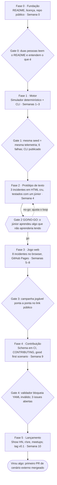
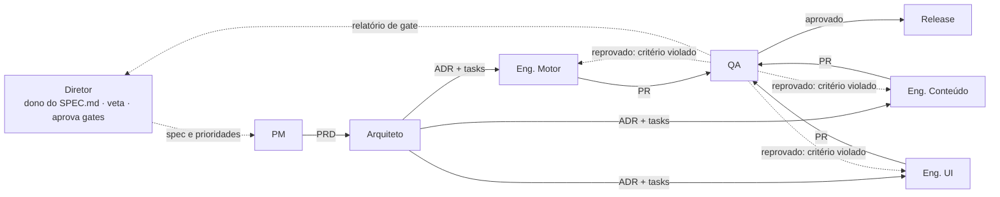

# Whodeployed — Spec Mestre

> **Spec-driven.** Este arquivo é a fonte de verdade do projeto. Só o Diretor altera este documento, via PR com ADR. Todo agente lê este arquivo inteiro antes de qualquer tarefa.

Versão 1.1 · 2026-10-26 · Jefferson Valente (Diretor)

> **Changelog:** 1.1 (2026-10-26): §2 "Como medir" e §10 (aprendizado) passam a pré e pós-teste com dois incidentes inéditos de dificuldade equivalente e ordem contrabalanceada ([ADR-011](docs/adr/ADR-011-pre-pos-teste.md)). 1.0 (2026-10-25): versão inicial.

## 1. Visão e tese

**Em uma frase:** um jogo de dedução no browser onde o jogador investiga incidentes de produção a partir de telemetria incompleta e progride de júnior a especialista aprendendo a fazer perguntas melhores, não a desbloquear ferramentas.

**Tese pedagógica:** observabilidade na prática é formar hipóteses a partir de sinais parciais sob pressão de tempo. Isso tem a estrutura de um jogo de mistério (pista, hipótese, evidência, culpado). O gráfico é a pista, não o jogo.

**Por que open source:** o projeto não visa receita. O valor é (a) existir em público e ser usado, (b) atrair cenários contribuídos pela comunidade SRE, (c) servir de peça de autoridade técnica em AIOps para o autor.

**O que NÃO é:**

- Não é uma "formação completa em observabilidade". SLO/SLI, design de alerta, instrumentação OTel e custo de ingestão estão fora da v0.x.
- Não é um clone de Grafana com sprites. A telemetria é simplificada e gerada por um motor, não uma UI de dashboard real.
- Não é um produto Steam nem um curso. É um link que roda no browser sem instalação.
- Não é um quiz. Não existe pergunta de múltipla escolha com resposta certa pré-rotulada; o jogador pede dados e decide.

**Referências de mercado que informam este spec:** SysOps Saga (Steam, 2024) tentou "carreira de SRE em jogo" com escopo amplo e ficou em 7 reviews em dois anos. SadServers, YouBrokeProd e SysAdmin Simulator crescem com escopo estreito e terminal real. Oh My Git ensina porque usa Git de verdade por baixo. Lição adotada: mecânica estreita e real, escopo pequeno, web-first.

## 2. Público e resultado de aprendizagem

**Jogador primário:** dev ou ops júnior/pleno (0–3 anos) que já viu um dashboard mas congela quando o alerta dispara. Sabe o que é latência e log, não sabe por onde começar.

**Jogador secundário:** sênior/SRE usando o jogo em onboarding de time, workshop ou meetup. Contribui cenários.

**Resultado de aprendizagem da v0.1 (um só, mensurável):** ao terminar a campanha, o jogador consegue, diante de um alerta novo, (1) perguntar "o que mudou?" antes de abrir qualquer gráfico, (2) escolher qual sinal olhar primeiro e justificar, (3) descartar uma hipótese com evidência, (4) decidir mitigar antes de ter root cause quando o impacto justifica.

**Como medir:** pré e pós-teste com dois incidentes inéditos de dificuldade equivalente, ausentes da campanha, gerados a partir de FaultKinds existentes com seed e noise próprios; ordem contrabalanceada entre testadores quando houver mais de um; métrica = número de sinais pedidos até a hipótese correta e se mitigou dentro do orçamento de impacto. Detalhes na seção 10.

## 3. Princípios de design (não negociáveis)

Todo agente da cadeia valida seu entregável contra esta lista. Violação = PR rejeitado.

1. **A mecânica é a habilidade.** Jogar é investigar. Nenhuma camada de "jogo" (pontos, XP, história) pode ser removida sem remover aprendizado; se puder, ela é decoração e sai.
2. **Progressão = perguntas, não ferramentas.** O jogador tem acesso a todos os sinais desde o incidente 1. O que evolui é o repertório de perguntas que ele pode fazer ao sistema (seção 5).
3. **Telemetria gerada, nunca roteirizada.** Cada incidente nasce de um motor determinístico (seed) que simula o sistema e injeta a falha. Logs, métricas e traces têm que ser coerentes entre si porque vêm da mesma simulação. Isso mata o "decoreba de padrão do jogo".
4. **Sinais mentem como na vida real.** Dashboard verde com usuário reclamando, alerta ruidoso sem impacto, métrica agregada escondendo um pod. Cada cenário declara qual engano ele ensina a detectar.
5. **Mitigar é válido sem root cause.** O jogo recompensa reduzir impacto cedo e investigar depois, como um postmortem de verdade. Root cause antes de mitigação com impacto alto é penalizado.
6. **Web-first, zero instalação.** Roda em GitHub Pages, abre no celular, link compartilhável. Nenhuma dependência de backend na v0.x.
7. **Conteúdo é dado.** Cenários, serviços e falhas são YAML validado por schema. Quem não programa consegue contribuir um incidente.
8. **Escopo pequeno e público.** Um sistema, uma campanha, publicado feio e cedo. Cada fase termina com algo no ar.

## 4. Escopo v0.1 e fora de escopo

**Dentro (v0.1 — "jogável e público"):**

| Item | Definição |
| --- | --- |
| Sistema fictício | 1 loja virtual: `gateway`, `auth`, `catalog`, `cart`, `payment`, `orders-worker`, `postgres`, `redis`, `queue`. 6 serviços + 3 dependências. |
| Sinais | Métricas (RPS, latência p50/p95/p99, erro %, CPU, mem, conexões), logs estruturados por serviço, traces simplificados (árvore de spans com duração e status), eventos de deploy/config. |
| Campanha | 8 incidentes em dificuldade crescente, cada um ensina um engano ou técnica específica (seção 7). |
| Loop | Alerta → pedir sinais → anotar hipótese → testar → mitigar e/ou corrigir → revisão pós-incidente automática. |
| Progressão | 3 níveis (Júnior, Pleno, Sênior) que desbloqueiam perguntas (seção 5). |
| Interface | Web, 2D simples: mapa dos serviços, painel de sinais, caderno de hipóteses, relógio de impacto. |
| Distribuição | GitHub Pages + README + CONTRIBUTING + schema de cenário. |

**Fora (v0.2+ ou nunca):**

- Multiplayer, chat, Incident Commander em time.
- Integração com Grafana/New Relic/Datadog reais.
- Backend, contas, leaderboard persistente.
- Design de alertas, SLO, instrumentação OTel, FinOps de telemetria.
- Arte elaborada, animação, trilha sonora. Sprites de placeholder são aceitáveis até v0.3.
- Localização: v0.1 em inglês (alcance open source); pt-BR como primeira tradução na v0.2.

## 5. Modelo de progressão júnior → sênior

O jogador não ganha ferramentas; ganha **verbos**. Cada nível adiciona perguntas que o sistema aceita. O custo de cada pergunta é tempo de incidente (o relógio de impacto corre).

| Nível | Perguntas disponíveis | O que o nível ensina | Como sobe |
| --- | --- | --- | --- |
| Júnior | Ver dashboard pronto de um serviço; ler alerta; ver logs dos últimos 5 min de um serviço; reiniciar serviço | Olhar o sinal certo primeiro; perceber que "verde" não é "saudável" | Resolver incidentes 1–3 com ≤ 2 hipóteses erradas |
| Pleno | Tudo do Júnior + filtrar logs por campo; comparar métrica entre instâncias; abrir trace de uma request lenta; "o que mudou?" (deploys/configs recentes); rollback | Correlacionar sinais; isolar por dimensão; suspeitar da mudança | Resolver 4–6 mitigando antes de 50% do orçamento de impacto |
| Sênior | Tudo do Pleno + pedir contexto a um NPC (dev do serviço, DBA); comparar com semana passada; feature flag off; declarar mitigação sem root cause; escalar | Saber o que não olhar; decidir sob incerteza; usar pessoas como sinal | Resolver 7–8; revisão pós-incidente sem passo redundante |

**Regra de ouro:** nenhuma pergunta de nível superior é necessária para resolver um incidente de nível inferior. Ela só torna a resolução mais rápida ou mais segura. Isso evita gating artificial.

**Revisão pós-incidente (o professor do jogo):** ao fim de cada incidente o motor mostra a linha do tempo do jogador contra um caminho de referência: quais perguntas foram redundantes, qual sinal já continha a resposta, quanto impacto a mitigação tardia custou. Sem nota numérica; três frases geradas a partir do log de ações.

## 6. Arquitetura

Três pacotes num monorepo TypeScript. O motor não conhece a UI; a UI não conhece YAML. Cenários são dados.

| Pacote | Responsabilidade | Depende de | Entregável isolado |
| --- | --- | --- | --- |
| `packages/engine` | Simula o sistema tick a tick (1 tick = 10 s de jogo). Gera métricas, logs, traces e eventos coerentes. Injeta falhas. Determinístico por seed. Expõe `ask(question) → signal`. | nada | Biblioteca npm + CLI que exporta telemetria sintética (JSON/NDJSON). Usável sem o jogo. |
| `packages/scenarios` | Schema JSON Schema do cenário, loader YAML, validador, 8 cenários da campanha, caminho de referência por cenário. | engine (tipos) | CLI `validate` rodando em CI. |
| `apps/web` | Jogo no browser: mapa de serviços, painel de sinais, caderno de hipóteses, relógio de impacto, revisão pós-incidente. | engine, scenarios | Site estático em GitHub Pages. |

**Stack fixada:** TypeScript 5, pnpm workspaces, Vitest, Vite. UI em React + Canvas/SVG para o mapa (Phaser só se o Agente de UI provar necessidade na fase 3). Zero backend. Estado do jogador em `localStorage`.

**Contrato central do motor (fixo a partir da fase 1):**

```typescript
interface World { services: Service[]; deps: Dependency[]; tick: number; seed: string }
interface Fault { kind: FaultKind; target: string; startTick: number; params: Record<string, number> }
type Question =
  | { kind: 'dashboard'; service: string }
  | { kind: 'logs'; service: string; window: number; filter?: Record<string, string> }
  | { kind: 'trace'; service: string; percentile: 50 | 95 | 99 }
  | { kind: 'whatChanged'; window: number }
  | { kind: 'compare'; service: string; metric: string; by: 'instance' | 'lastWeek' }
  | { kind: 'askNpc'; role: 'dev' | 'dba' | 'oncall' }
interface Answer { question: Question; data: Signal; tickCost: number }
type Action = { kind: 'restart' | 'rollback' | 'flagOff' | 'scale' | 'escalate' | 'declareMitigated'; target?: string }
```

**Layout do repo:**

```
/README.md  /CONTRIBUTING.md  /LICENSE (Apache-2.0)  /SPEC.md (este documento)
/packages/engine/src/{world,faults,signals,questions,sim}.ts
/packages/scenarios/{schema.json, scenarios/*.yaml, src/validate.ts}
/apps/web/src/{map,signals,notebook,clock,review}/
/.github/workflows/{ci.yml, pages.yml}
/docs/adr/  (uma ADR por decisão de arquitetura)
```

## 7. Formato de cenário (YAML)

Um cenário declara a falha, o que ela ensina, o engano que ela planta e o caminho de referência. O motor gera o resto. Campos obrigatórios marcados com `*`.

```yaml
id: 03-connection-pool-exhausted*
title: "Checkout slow on launch day"*
level: junior | pleno | senior*
teaches: "Aggregated latency hides a single saturated dependency"*
trap: "Gateway dashboard is green; the pain is in payment -> postgres"*
seed: "launch-day-01"*
system: default-shop            # referencia packages/scenarios/systems/
faults:*
  - kind: connection_pool_exhaustion
    target: payment
    startTick: 12
    params: { poolSize: 20, leakPerTick: 2 }
noise:                           # alertas e eventos que distraem
  - kind: deploy
    target: catalog
    tick: 10
    note: "harmless frontend copy change"
alert:*
  tick: 18
  text: "p95 latency checkout > 2s for 3m"
impactBudget: 60                 # ticks ate 'incidente grave'
referencePath:*                  # caminho esperado, usado na revisao
  - { ask: whatChanged, window: 30 }
  - { ask: trace, service: payment, percentile: 95 }
  - { ask: dashboard, service: postgres }
  - { act: scale, target: payment }       # mitigacao
  - { act: declareMitigated }
rootCause: "payment leaks DB connections on retry path"*
review:
  redundant: ["dashboard gateway"]
  keySignal: "trace shows 1.9s waiting on db.acquire"
```

**Campanha v0.1 (8 cenários, cada um com um `teaches` distinto):**

| # | Nível | Falha | Ensina |
| --- | --- | --- | --- |
| 1 | Júnior | Serviço crashando em loop | Ler o alerta e o log certo primeiro |
| 2 | Júnior | Disco cheio no postgres | Sintoma longe da causa; seguir a dependência |
| 3 | Júnior | Pool de conexões esgotado | Agregado esconde um gargalo |
| 4 | Pleno | Deploy ruim em 1 de 3 instâncias | Comparar por instância; rollback |
| 5 | Pleno | Retry storm após dependência lenta | Cascata; o culpado não é quem grita |
| 6 | Pleno | Alerta ruidoso sem impacto real | Saber ignorar; custo de investigar o nada |
| 7 | Sênior | Cache frio após restart de redis | Mitigar sem root cause; usar NPC |
| 8 | Sênior | Duas falhas simultâneas | Priorizar por impacto; escalar |

## 8. Fases, gates e critérios de aceite

Seis fases, cada uma fechando com algo público. Nenhuma fase começa sem o gate anterior verde; o gate 2 é o único go/no-go do projeto.



Se o gate 2 falhar, o retorno é à fase 2 com o loop ajustado, nunca à fase 3. O motor da fase 1 permanece como release útil mesmo sem jogo.

**Critérios de aceite por fase (o que o agente QA verifica):**

| Fase | Entregáveis | Critério objetivo |
| --- | --- | --- |
| 0 Fundação | README, LICENSE, CONTRIBUTING esboço, repo público, este SPEC em `/SPEC.md`, ADR-001 (stack) | README responde "o que é, pra quem, como rodar, como contribuir" em ≤ 1 tela |
| 1 Motor | `packages/engine` com `World`, 6 `FaultKind`, geração de métricas/logs/traces/eventos, `ask()`, CLI `simulate --seed --fault --ticks` | Testes ≥ 80% em `sim` e `faults`; seed idêntica = saída byte-idêntica; propriedade "métrica agregada é derivável dos spans do tick" passa |
| 2 Protótipo | Página HTML sem estilo com 3 cenários (1, 3, 5); log de ações exportável; roteiro de teste com júnior | Sessão gravada com 1 júnior; pós-teste mostra mudança de comportamento em pelo menos 1 dos 4 resultados da seção 2 |
| 3 Jogo web | `apps/web` com mapa, painel, caderno, relógio, revisão; 8 cenários; progressão; i18n strings; Pages | Campanha completável sem bug bloqueante; regra de ouro (seção 5) validada em cada cenário; Lighthouse a11y ≥ 90 |
| 4 Contribuição | `schema.json`, `validate` em CI, CONTRIBUTING completo, template de issue/PR, 3 issues `good first scenario` | PR com YAML inválido falha em CI com mensagem legível; um não-dev consegue preencher o template |
| 5 Lançamento | Tag v0.1, post de lançamento, GIF de 20 s, submissões nas comunidades | Postado em ≥ 4 canais; 5 jogadores externos com pós-teste respondido |

## 9. Cadeia de agentes

Sete papéis, cada um com entrada e saída em arquivo no repo. Nenhum agente fala com outro fora de artefato versionado; o repositório é o barramento. O humano (autor) ocupa o papel de Diretor na v0.1 e pode delegar a um agente depois.



Os três engenheiros trabalham em paralelo a partir da mesma ADR; QA só recebe PR com checklist preenchido; Release só recebe aprovação de QA e do gate.

| Agente | Recebe | Entrega | Handoff aceito quando |
| --- | --- | --- | --- |
| **Diretor** | Este SPEC.md; relatório de gate do QA | Decisões da seção 12; veto ou aprovação de gate; prioridade da próxima fase | Gate registrado em `/docs/gates/GATE-N.md` com data e evidência |
| **PM** | SPEC.md; fase atual; feedback de testadores | `/docs/prd/FASE-N.md`: histórias, critérios de aceite verificáveis, fora de escopo explícito, roteiro de teste com júnior (fase 2) | Cada critério é testável por máquina ou por roteiro escrito; nenhum "deve ser intuitivo" |
| **Arquiteto** | PRD da fase; contrato da seção 6 | ADRs em `/docs/adr/`; `tasks.md` com tarefas ≤ 1 dia cada, dono (motor/conteúdo/UI) e dependências; interfaces TS atualizadas | Tipos compilam; nenhuma tarefa cruza dois pacotes sem interface definida |
| **Eng. Motor** | Tasks de `packages/engine` | PRs com testes; CLI; fixtures de telemetria para a UI | Cobertura ≥ 80%; determinismo por seed provado em teste; propriedade de coerência passa |
| **Eng. Conteúdo** | Tasks de `packages/scenarios`; lista de `teaches` da seção 7 | 8 YAMLs; schema; caminhos de referência; textos de alerta, NPC e revisão | Validador passa; cada cenário resolvível só com perguntas do seu nível (regra de ouro) |
| **Eng. UI** | Tasks de `apps/web`; fixtures do motor | Telas em React; i18n; deploy Pages | Campanha completável; a11y ≥ 90; funciona em 390 px de largura |
| **QA** | PRs com checklist; PRD da fase | Relatório por PR (aprovado/reprovado + critério); relatório de gate; bugs como issues | Verificou cada critério do PRD e cada princípio da seção 3; sem auto-aprovação de código que ele mesmo tocou |
| **Release** | Aprovação de QA + gate | Tag, changelog, post de lançamento, GIF, submissões, resposta a issues nos 7 dias seguintes | Checklist de lançamento em `/docs/release/v0.1.md` completo |

**Prompt-base de cada agente (cabeçalho obrigatório):** "Leia `/SPEC.md` inteiro. Seu papel é X. Sua entrada é Y em Z. Sua saída é W em V. Antes de entregar, confirme item a item que W respeita os 8 princípios da seção 3 e o escopo da seção 4. Se precisar decidir algo da seção 12, pare e pergunte ao Diretor; se for decisão delegada, registre uma ADR."

**Regras da cadeia:**

1. Todo artefato é arquivo versionado. Conversa entre agentes que não virou arquivo não existe.
2. QA nunca é o mesmo agente que escreveu o código. Quem produz não se avalia.
3. Reprovação volta para o engenheiro com o critério violado citado, não com opinião.
4. Diretor é o único que pode mudar SPEC.md. Mudança de spec é PR com ADR.
5. Nenhum agente abre fase N+1 sem `GATE-N.md` aprovado.

## 10. Definição de pronto e métricas

**v0.1 está pronta quando:** link público no GitHub Pages, 8 incidentes jogáveis do início ao fim, revisão pós-incidente funcionando, schema de cenário validado em CI, CONTRIBUTING com template de cenário, e **pelo menos um jogador externo terminou a campanha e respondeu ao pós-teste.**

**O projeto "virou algo" quando:** um PR de cenário de alguém que não é o autor foi mergeado.

| Métrica | Como coletar | Alvo v0.1 |
| --- | --- | --- |
| Aprendizado: sinais pedidos até hipótese correta nos incidentes de teste | Pré e pós-teste com dois incidentes inéditos de dificuldade equivalente, ausentes da campanha, gerados a partir de FaultKinds existentes com seed e noise próprios; ordem contrabalanceada entre testadores quando houver mais de um; log de ações exportado pelo jogador | Redução ≥ 30% entre pré e pós |
| Aprendizado: mitigou dentro do orçamento de impacto | Mesmo teste | ≥ 70% dos testadores no pós |
| Conclusão da campanha | localStorage exportado voluntariamente (sem telemetria automática na v0.1) | ≥ 5 jogadores externos |
| Contribuição | GitHub | 1 PR de cenário externo mergeado |
| Alcance | GitHub stars, visitas Pages (sem rastreio pessoal) | 100 stars em 90 dias |

**Qualidade de código (CI bloqueia merge):** testes do motor ≥ 80% de cobertura em `sim` e `faults`; mesma seed produz telemetria byte-idêntica; todo cenário passa no validador; build do site sem warnings; Lighthouse acessibilidade ≥ 90.

## 11. Riscos e mitigações

| Risco | Sinal de alerta | Mitigação |
| --- | --- | --- |
| Virar curso com pixel art (escopo infla) | Issue ou PR adicionando conceito sem cenário jogável | Princípio 1: se dá pra tirar a mecânica e manter o conteúdo, não entra. Agente Diretor veta. |
| Gamesmanship: jogador decora padrão do jogo | Testadores resolvem incidente novo pedindo os mesmos sinais sempre | Noise e seed variam por partida; revisão penaliza pergunta redundante; cenário 6 ensina a não investigar |
| Motor gera telemetria incoerente | Trace diz uma coisa, métrica diz outra | Teste de propriedade: toda métrica agregada deve ser derivável dos spans gerados no mesmo tick |
| Gating artificial (ferramenta travada) | Jogador trava por falta de pergunta, não por raciocínio | Regra de ouro da seção 5 testada por agente QA em todo cenário |
| Projeto morre a 70% | Duas semanas sem commit | Cada fase termina com deploy público; motor sozinho já é release |
| Arte consome o tempo | Hora em tileset antes da fase 3 | Placeholder geométrico até v0.3; arte só por contribuição externa |
| Ninguém contribui cenário | 60 dias sem PR externo | Issues `good first scenario` com falha já escolhida; template preenchido pela metade |
| Inglês afasta público BR | Feedback em pt-BR pedindo tradução | i18n desde a fase 3 (strings em arquivo); pt-BR na v0.2 |

## 12. Decisões abertas e glossário

**Decisões que o autor toma antes da fase 0 (bloqueiam os agentes):**

- [x] Nome do projeto: **Whodeployed** (repo `jeffersonvalente/whodeployed`). Tagline: "the dashboard is green and it's lying".
- [x] Licença: Apache-2.0.
- [x] Idioma da v0.1: inglês na interface e no código; este spec e os docs internos em pt-BR.
- [ ] Canvas/SVG puro vs Phaser para o mapa (decidir na fase 3 com protótipo de 1 dia cada).
- [ ] Tom narrativo: neutro-realista (sugerido) ou humorístico.

**Decisões que os agentes podem tomar sozinhos (registrar em ADR):** estrutura interna do motor, formato de trace simplificado, biblioteca de validação de schema, layout do painel, paleta.

**Glossário:**

| Termo | Significado neste spec |
| --- | --- |
| Tick | Unidade de tempo do motor; 1 tick = 10 s de jogo |
| Pergunta | Ação de leitura do jogador contra o sistema (`Question`); custa ticks |
| Ação | Intervenção no sistema (`Action`); muda o estado |
| Orçamento de impacto | Ticks até o incidente virar "grave"; define quando mitigar cedo compensa |
| Caminho de referência | Sequência esperada de perguntas e ações, usada só na revisão, nunca mostrada antes |
| Trap | O engano que o cenário planta de propósito e ensina a detectar |
| Noise | Alertas e eventos irrelevantes gerados para distrair |
| Gate | Critério objetivo que libera a próxima fase |
